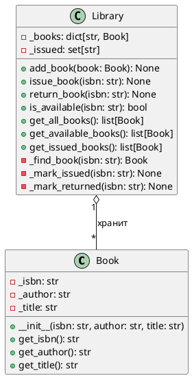

## 1. Классы

существительные:

| Существительное | Класс или нет? | Почему |
|---|---|---|
| Книга | **Да** (Book) | Главный объект системы, у неё есть данные и состояние |
| ISBN | Нет, атрибут Book | уникальный номер книги |
| Автор | Нет, атрибут Book | просто текст |
| Название | Нет, атрибут Book | Просто текст |
| Читатель | Пока нет | Мы их пока не различаем |
| Библиотека | **Да** (Library) |  Кто-то должен хранить книги и выдавать их |
| Полка | Нет, состояние книги | просто состояние |
| Список книг | Нет | не отдельная сущность |

классы Book и Library. Читатель пока не класс

## 2. Атрибуты и поведение

### Book (книга)

**Что знает (атрибуты):**
- ISBN (строка)
-  автор (строка)
- название (строка)

**Что умеет (поведение):**
- сообщить свой ISBN, автора и название

> Книга сама не знает выдана она или нет

### Library 

**Что знает (атрибуты):**
- все книги (словарь: ISBN → книга)
- какие книги сейчас выданы (множество ISBN)

**Что умеет (поведение):**
- добавить книгу в фонд
- выдать книгу читателю
- принять книгу обратно
- проверить, доступна ли книга
- показать список всех книг
- показать список доступных книг
- показать список выданных книг

### Читатель (пока не класс)

Сейчас читатель никак не хранится. Если захотим знать, у кого какая книга, понадобится класс `Reader`

## 3. Инварианты

1. Книга не может быть одновременно выдана и доступна 
2. ISBN уникален
3. Выданную книгу нельзя выдать ещё раз 
4. Вернуть можно только ту книгу, которая сейчас выдана
5. Выдать или вернуть можно только книгу, которая есть в библиотеке
6. ISBN, автор и название книги не меняются после создания
7. Любая книга из фонда всегда доступна или выдана

## UML-диаграмма

Обозначения: `+` публичный, `-` внутренний.

---

## Ответы на вопросы

### Вопрос 1. Какие атрибуты Book должны быть неизменяемыми после создания? Почему?

Все три атрибута: ISBN, автор и название. ISBN обязательно,по нему библиотека находит книгу, и если его поменять, книга потеряется. Автор и название это данные об уже существующей книге, их случайное изменение испортит каталог

### Вопрос 2. Где должно храниться состояние «книга выдана / доступна» — в классе Book или в классе Library? Обоснуйте.

Я храню это состояние в классе `Library`. Выдана книга или нет, это не свойство самой книги, а факт из библиотеки. Именно библиотека выдаёт и принимает книги

### Вопрос 3. Какие методы Library должны быть публичными, а какие — внутренними? Приведите пример метода, который не должен быть публичным, и объясните, что может пойти не так, если его сделать публичным.

Публичными (`+`) должны быть методы, которыми пользуется библиотекарь: `add_book`, `issue_book`, `return_book`, `is_available` и методы получения списков. Внутренними (`-`) должны быть вспомогательные методы: `_find_book`, `_mark_issued`, `_mark_returned`. Например, `_mark_issued` просто записывает ISBN в множество выданных и ничего не проверяет. Если сделать его публичным, кто-то сможет вызвать его напрямую, в обход `issue_book`, и тогда книга будеет выдана дважды или будет помечена выданной книга, которой нет в библиотеке
